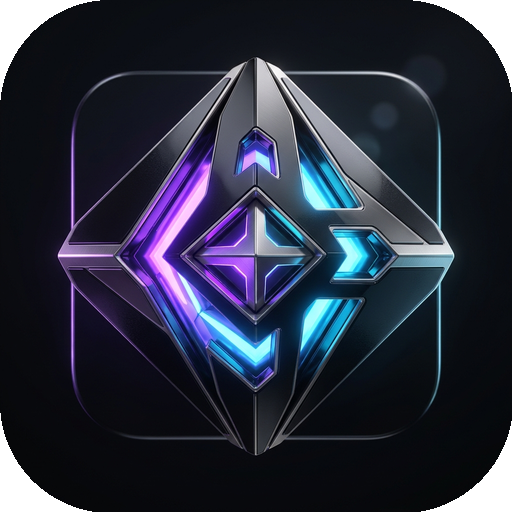

# ✦ OmniVault Desktop v2.0 - Universal Media Hub & Creative Suite

<p align="center">
  
  <br><br>
  
  <br>
  <b>Bóveda Multimedia Universal • Suite Creativa • Descargador de Alto Rendimiento</b>
</p>

> **Aplicación de escritorio de alto rendimiento para descarga, conversión, recorte y gestión multimedia.**  
> Diseñada en arquitectura modular con estética prémium *Obsidian & Titanium*, soporte multiresolución responsivo, aceleración por hardware GPU, aceleración multihilo con `aria2c`, normalización de audio EBU R128, transcriptor de subtítulos con IA, Mini-HUD flotante Picture-in-Picture y sincronización automática de creadores.

---

## 🎨 Paleta de Diseño: *Obsidian & Titanium*

- **Negro Obsidiana (`#0F1012`):** Base oscura profunda diseñada para eliminar la fatiga visual.
- **Grafito Oscuro (`#1A1D22`):** Paneles y tarjetas estructuradas de alto contraste.
- **Plata Titanio (`#E2E8F0` / `#FFFFFF`):** Botones principales de acción táctil.
- **Color de Acento Personalizable:** Elige entre 5 temas de acento:
  - 🟣 **Cyberpunk Violet** (Predeterminado)
  - 🔵 **Electric Blue**
  - 🟢 **Emerald Matrix**
  - 🟠 **Sunset Orange**
  - 🌸 **Rose Quartz**

---

## 🚀 Guía Completa de Funcionalidades

### 1. 📥 Descargas Individuales y Detección Automática
- Pega cualquier enlace de más de 1000 plataformas compatibles (**YouTube, TikTok, SoundCloud, Instagram, Facebook, Twitter/X, Twitch**, etc.).
- **Smart Auto-Paste:** Al copiar un enlace en tu navegador o cualquier programa, OmniVault lo detecta en el portapapeles y te muestra un banner flotante para analizarlo con 1 clic sin tener que pegarlo manualmente.
- **Separación Inteligente de Carpetas:**
  - Los audios (`MP3`, `WAV`, `M4A`, `FLAC`) se guardan automáticamente en tu carpeta del sistema: `Música\OmniVault Audios`.
  - Los videos (`MP4`, `MKV`) se guardan automáticamente en: `Videos\OmniVault Videos`.
  - Puedes cambiar ambas rutas en cualquier momento desde **⚙ Ajustes**.

---

### 2. ✂️ Recorte de Fragmentos de Audio y Video (*Trim & Clip*)
¿Solo necesitas el estribillo de una canción, el solo de guitarra o una escena específica de un podcast de 3 horas?
1. Pega y analiza el enlace en la pestaña **Explorar / Buscar**.
2. En la tarjeta de vista previa, marca la casilla: **✂️ Recortar fragmento específico**.
3. Ingresa los tiempos:
   - **Desde (Inicio):** Ejemplos: `01:15` o `00:01:15` o `75`.
   - **Hasta (Fin):** Ejemplos: `02:30` o `00:02:30` (o déjalo vacío para descargar desde el inicio indicado hasta el final del video).
4. Elige tu formato preferido y haz clic en **⬇ DESCARGAR AHORA**.
5. OmniVault recortará el fragmento exacto con precisión de milisegundos mediante FFmpeg.

---

### 3. 📊 Estimación de Peso y Tamaño de Archivo
Antes de iniciar cualquier descarga, OmniVault analiza los flujos disponibles y te muestra el **peso aproximado** que ocupará cada calidad en tu disco duro:
- `MP3 320 kbps HD (~8.4 MB)`
- `MP3 192 kbps (~5.0 MB)`
- `MP4 1080p Full HD (~72.5 MB)`
- `MP4 720p HD (~36.0 MB)`
- etc.

---

### 4. 🔄 Conversor Multimedia Local Offline (*Herramienta Offline*)
OmniVault incluye un conversor multimedia completo que opera **100% de manera local en tu PC**, sin conexión a internet y sin subir tus archivos privados a servidores externos:
1. En la barra lateral, haz clic en **🔄 Conversor Local**.
2. Haz clic en **📁 Examinar...** y selecciona cualquier archivo de tu ordenador (`.mp4`, `.mkv`, `.avi`, `.mov`, `.flv`, `.webm`, `.mp3`, `.wav`, `.m4a`, `.aac`, `.flac`, `.ogg`).
3. El programa detectará automáticamente la duración, tamaño y tipo de flujo (audio/video).
4. Elige el formato de salida:
   - **🎵 Formatos de Audio:** `MP3 (320 kbps HD)`, `MP3 (192 kbps)`, `WAV (Estudio)`, `M4A (AAC 256k)` o `FLAC (Lossless)`.  
     *(¡Ideal para extraer el audio de cualquier video en 1 clic!)*
   - **🎬 Formatos de Video:** `MP4 H.264` o **Comprimir Video (Reduce hasta un 50% el tamaño manteniendo gran nitidez)**.
5. Selecciona la carpeta de destino y presiona **⚡ INICIAR CONVERSIÓN**.
6. Observa la barra de progreso en vivo con porcentaje, velocidad de procesamiento (`4.5x`) y tiempo restante.
7. Al terminar, presiona **📂 Abrir Archivo** para reproducirlo o compartirlo de inmediato.

---

### 5. ⚡ Aceleración de Red (Aria2c) y Hardware GPU
- **Acelerador Multihilo Aria2c:**
  - OmniVault detecta automáticamente `aria2c.exe` (en `bin/`, en tu `PATH`, en Scoop o Chocolatey).
  - Cada descarga pesada se divide en **8 conexiones simultáneas en paralelo** (`-s 8 -x 8 -k 1M -j 4`), multiplicando la velocidad de descarga hasta por 5x.
- **Aceleración por Tarjeta Gráfica (GPU):**
  - Detección automática de hardware:
    - 🔴 **AMD Radeon:** Codificación por hardware **AMD AMF** (`h264_amf`).
    - 🟢 **NVIDIA GeForce:** Codificación por hardware **NVIDIA NVENC** (`h264_nvenc`).
    - 🔵 **Intel Graphics:** Codificación por hardware **Intel QuickSync** (`h264_qsv`).
  - Convierte y comprime videos a velocidades ultra rápidas sin sobrecargar tu procesador (CPU).

---

### 6. 🔕 Minimizar a la Bandeja del Sistema (*System Tray / Reloj de Windows*)
- Al cerrar la ventana o minimizarla, OmniVault puede quedarse discretamente en segundo plano al lado del reloj de Windows.
- Permite que las descargas largas continúen sin interrumpirse y que el detector inteligente de portapapeles siga vigilando mientras juegas o trabajas.
- Haz clic derecho sobre el icono en la bandeja para:
  - **✦ Abrir OmniVault**
  - **⏸ / ▶ Pausar o Reanudar Descargas**
  - **❌ Salir de OmniVault**
- Puedes activar o desactivar este comportamiento en cualquier momento desde **⚙ Ajustes**.

---

### 7. 🔊 Normalización Inteligente de Volumen (Estándar EBU R128)
¿Cansado de canciones que suenan demasiado bajas y otras que te rompen los oídos?
- Activa la casilla **🔊 Normalizar Volumen (EBU R128)** en Ajustes o durante la descarga individual.
- OmniVault analiza la curva psicoacústica del audio y ajusta los decibelios de sonoridad integrada a **-14 LUFS** (el estándar de Spotify, YouTube Music y Apple Music), asegurando que toda tu biblioteca musical suene con volumen parejo y sin saturación.

---

### 8. 📝 Transcriptor Inteligente de Subtítulos con IA (.SRT y .TXT)
Extrae el audio de cualquier video de tu PC o descargado y genera subtítulos profesionales con marcas de tiempo precisas:
1. En la barra lateral, haz clic en **📝 Transcriptor IA**.
2. Selecciona un archivo de video o audio.
3. Elige el idioma de transcripción:
   - 🇪🇸 Español (es-ES / es-MX / es-AR / es-CO / es-CL / es-PE)
   - 🇺🇸 Inglés (en-US / en-GB)
   - 🇧🇷 Portugués, 🇫🇷 Francés, 🇩🇪 Alemán, 🇮🇹 Italiano, 🇯🇵 Japonés, etc.
4. Presiona **✨ INICIAR TRANSCRIPCIÓN**.
5. Obtendrás un archivo de subtítulos sincronizado (`.srt`) compatible con reproductores de video (VLC, Premiere, DaVinci) y un resumen en texto plano (`.txt`).

---

### 9. 🪟 Mini-Widget Flotante Always-on-Top (Mini-HUD PiP)
Si estás jugando a pantalla completa, editando o trabajando en otra ventana:
- Activa el **Mini-HUD** desde Ajustes o con un clic.
- Una barra flotante compacta y arrastrable permanecerá siempre al frente sobre tus aplicaciones.
- Muestra la velocidad en tiempo real, barra de progreso general, atajos de pausa/reanudación y un botón de descarga rápida con 1 clic para enlaces en el portapapeles.

---

### 10. 🔔 Monitoreo Automático de Canales y Creadores (*Channel Auto-Sync*)
No te pierdas ningún video de tus canales favoritos de YouTube ni directos:
1. Ve a la pestaña **🔔 Creadores**.
2. Añade la URL del canal de YouTube o perfil.
3. Elige tu formato predilecto (`MP3 320k` o `MP4 1080p`).
4. OmniVault revisará periódicamente en segundo plano y descargará automáticamente los nuevos lanzamientos.

---

### 11. 🎵 Mini-Reproductor de Audio Integrado
Escucha tus canciones descargadas inmediatamente dentro de OmniVault sin abrir reproductores pesados de terceros:
- Control de reproducción (Play / Pause).
- Barra de desplazamiento milimétrica (Seek).
- Deslizador de volumen en tiempo real.
- Atajos de teclado: barra espaciadora para reproducir/pausar, Escape para cerrar.

---

## 🏗️ Estructura del Proyecto

```text
UniversalMediaDownloader/
├── app.py                      # Interfaz gráfica principal y controlador central
├── main.py                     # Punto de entrada estándar para Python
├── downloader.py               # Motor de descarga con yt-dlp, FFmpeg y Aria2c
├── converter.py                # Conversor multimedia local y compresión GPU
├── transcriber.py              # Extracción y transcripción de voz a subtítulos (.SRT)
├── queue_manager.py            # Gestor de cola multihilo concurrente
├── history_manager.py          # Registro atómico de biblioteca descargada
├── config_manager.py           # Gestor de ajustes y preferencias del usuario
├── subscriptions_manager.py    # Monitoreo y auto-descarga de canales
├── audio_player.py             # Reproductor nativo de audio vía Windows MCI
├── notifications.py            # Notificaciones Toast nativas de Windows
├── mini_hud.py                 # Ventana flotante Picture-in-Picture
├── tray.py                     # Integración con la bandeja del sistema (System Tray)
├── theme.py                    # Constantes de diseño Obsidian & Titanium
├── themes.py                   # Paletas de acento intercambiables
├── image_cache.py              # Caché LRU en memoria para carátulas
├── check_system.py             # Diagnóstico integral del sistema y dependencias
├── run_tests.py                # Ejecutor de pruebas unitarias
├── generate_assets.py          # Generador visual de iconos y logotipo
├── build_exe.py                # Compilador con PyInstaller a binario autónomo
├── compilar.bat                # Acceso rápido para compilar a .exe
├── iniciar.bat                 # Lanzador sin ventana de consola (pyw)
├── iniciar_consola.bat         # Lanzador con ventana de depuración
├── installer.iss               # Script de Inno Setup para instalador oficial
├── requirements.txt            # Dependencias oficiales de Python
├── LICENSE                     # Licencia de código abierto MIT
├── assets/                     # Recursos gráficos oficiales
│   ├── icon.ico                # Icono de la aplicación multi-resolución
│   ├── icon.png                # Icono maestro en alta definición
│   ├── logo.png                # Logotipo horizontal
│   └── omnivault_artwork.jpg   # Carátula oficial de OmniVault
└── tests/                      # Suite completa de pruebas unitarias
    ├── test_config.py
    ├── test_downloader_helpers.py
    ├── test_history.py
    ├── test_themes.py
    └── test_transcriber.py
```

---

## ⚙️ Instalación y Requisitos

### 1. Requisitos del Sistema
- **Windows 10 u 11** (64 bits).
- **Python 3.10 o superior** (o utiliza el instalador compilado).

### 2. Instalación de Dependencias
Abre la consola en la carpeta del proyecto y ejecuta:
```bash
py -m pip install -r requirements.txt
```

### 3. Diagnóstico del Entorno
Verifica que tu sistema cuente con todo lo necesario ejecutando:
```bash
py check_system.py
```

### 4. FFmpeg y Aria2c
- **FFmpeg:** Detección automática en el sistema (mediante `winget install Gyan.FFmpeg`, en la carpeta `bin/` o en tu `PATH`).
- **Aria2c (Opcional):** Detección en `bin/aria2c.exe`, Scoop, Chocolatey o `PATH`.

---

## ▶️ Cómo Ejecutar la Aplicación

### Modo Ventana Limpia (Recomendado - Sin Terminal)
Haz doble clic en:
```text
iniciar.bat
```
*(Utiliza el lanzador `pyw` nativo de Windows: la interfaz se abre directamente sin ventanas negras de terminal).*

### Modo Terminal Estándar
```bash
py main.py
```

### Modo Depuración (Con Consola)
```text
iniciar_consola.bat
```

---

## 🧪 Ejecución de Pruebas Unitarias

Para verificar la integridad y correcto funcionamiento de todos los módulos:
```bash
py run_tests.py
```

---

## 📦 Empaquetado y Publicación Profesional (Releases)

### Generación de Paquetes Locales (Portátil + Instalador + Checksums)
Haz doble clic en:
```text
empaquetar.bat
```
O ejecuta en terminal:
```bash
py package_release.py
```
Este proceso generará automáticamente en la carpeta `dist\Releases\`:
1. `OmniVault-v2.0.0-Windows-x64-Setup.exe` (Instalador oficial guiado)
2. `OmniVault-v2.0.0-Windows-x64-Portable.zip` (Versión sin instalación)
3. `SHA256SUMS.txt` (Sumas criptográficas de verificación)

### Automatización CI/CD en GitHub
El proyecto cuenta con GitHub Actions preconfigurado (`.github/workflows/release.yml`). Para publicar una nueva versión automáticamente:
```bash
git tag v2.0.0
git push origin v2.0.0
```
Consulta la [**Guía Completa de Lanzamientos (RELEASE_GUIDE.md)**](RELEASE_GUIDE.md) para más detalles.

---

## 🛡️ Seguridad y Privacidad
- **Cero telemetría y sin publicidad.**
- **Código abierto y transparente.**
- **Tus contraseñas nunca se solicitan ni se almacenan.**
- **Los archivos locales de configuración y cookies están estrictamente aislados y excluidos de Git.**
